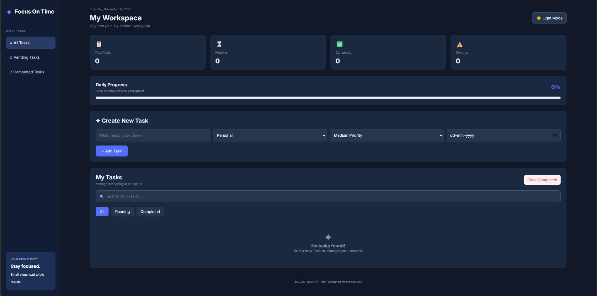

# Ex03 To-Do List using JavaScript
## Date: 17/11/2026

## AIM
To create a To-do Application with all features using JavaScript.

## ALGORITHM
### STEP 1
Build the HTML structure (index.html).

### STEP 2
Style the App (style.css).

### STEP 3
Plan the features the To-Do App should have.

### STEP 4
Create a To-do application using Javascript.

### STEP 5
Add functionalities.

### STEP 6
Test the App.

### STEP 7
Open the HTML file in a browser to check layout and functionality.

### STEP 8
Fix styling issues and refine content placement.

### STEP 9
Deploy the website.

### STEP 10
Upload to GitHub Pages for free hosting.

## PROGRAM

## index.html
```
<!DOCTYPE html>
<html lang="en">
<head>
    <meta charset="UTF-8">
    <meta name="viewport" content="width=device-width, initial-scale=1.0">

    <title>FocusFlow - Smart Todo App</title>

    <link rel="stylesheet" href="style.css">
</head>

<body>

<div class="app">

    <!-- Sidebar -->
    <aside class="sidebar">

        <div class="brand">
            <span class="brand-icon">✦</span>
            <h2>Focus On Time</h2>
        </div>

        <p class="menu-title">WORKSPACE</p>

        <button class="nav-btn active" data-filter="all">
            ◈ All Tasks
        </button>

        <button class="nav-btn" data-filter="active">
            ◷ Pending Tasks
        </button>

        <button class="nav-btn" data-filter="completed">
            ✓ Completed Tasks
        </button>

        <div class="sidebar-bottom">
            <p>YOUR PRODUCTIVITY</p>
            <h3>Stay focused.</h3>
            <small>Small steps lead to big results.</small>
        </div>

    </aside>

    <!-- Main Content -->
    <main class="main">

        <header class="topbar">
            <div>
                <p class="date-label" id="todayDate"></p>
                <h1>My Workspace</h1>
                <p class="subtitle">
                    Organize your day. Achieve your goals.
                </p>
            </div>

            <button id="themeBtn" class="theme-btn">
                🌙 Dark Mode
            </button>
        </header>

        <!-- Statistics -->
        <section class="stats">

            <div class="stat-card">
                <span>📋</span>
                <p>Total Tasks</p>
                <h2 id="totalCount">0</h2>
            </div>

            <div class="stat-card">
                <span>⏳</span>
                <p>Pending</p>
                <h2 id="pendingCount">0</h2>
            </div>

            <div class="stat-card">
                <span>✅</span>
                <p>Completed</p>
                <h2 id="completedCount">0</h2>
            </div>

            <div class="stat-card">
                <span>⚠️</span>
                <p>Overdue</p>
                <h2 id="overdueCount">0</h2>
            </div>

        </section>

        <!-- Progress -->
        <section class="progress-card">

            <div class="progress-info">
                <div>
                    <h3>Daily Progress</h3>
                    <p>Keep moving towards your goals!</p>
                </div>

                <h2 id="progressPercent">0%</h2>
            </div>

            <div class="progress-track">
                <div id="progressBar"></div>
            </div>

        </section>

        <!-- Add Task Form -->
        <section class="form-card">

            <h2 id="formHeading">✦ Create New Task</h2>

            <form id="taskForm">

                <div class="form-grid">

                    <input
                        type="text"
                        id="taskInput"
                        placeholder="What needs to be done?"
                        required
                        maxlength="100"
                    >

                    <select id="category">
                        <option value="Personal">Personal</option>
                        <option value="Study">Study</option>
                        <option value="Work">Work</option>
                        <option value="Health">Health</option>
                        <option value="Other">Other</option>
                    </select>

                    <select id="priority">
                        <option value="Low">Low Priority</option>
                        <option value="Medium" selected>
                            Medium Priority
                        </option>
                        <option value="High">High Priority</option>
                    </select>

                    <input type="date" id="dueDate">

                </div>

                <div class="form-actions">
                    <button type="submit" id="submitBtn">
                        + Add Task
                    </button>

                    <button type="button" id="cancelEdit"
                        class="cancel-btn" hidden>
                        Cancel
                    </button>
                </div>

            </form>

        </section>

        <!-- Task Section -->
        <section class="task-section">

            <div class="task-heading">
                <div>
                    <h2>My Tasks</h2>
                    <p>Manage everything in one place.</p>
                </div>

                <button id="clearCompleted" class="clear-btn">
                    Clear Completed
                </button>
            </div>

            <!-- Search -->
            <div class="search-box">
                <span>🔍</span>
                <input
                    type="search"
                    id="searchInput"
                    placeholder="Search your tasks..."
                >
            </div>

            <!-- Filter -->
            <div class="filters">

                <button class="filter-btn selected"
                    data-filter="all">
                    All
                </button>

                <button class="filter-btn"
                    data-filter="active">
                    Pending
                </button>

                <button class="filter-btn"
                    data-filter="completed">
                    Completed
                </button>

            </div>

            <!-- Task List -->
            <div id="taskList" class="task-list"></div>

        </section>

        <footer>
            <p>© 2026 Focus On Time | Designed for Productivity</p>
        </footer>

    </main>

</div>

<script src="script.js"></script>

</body>
</html>
```

## script.js

```
// =====================================
// FOCUSFLOW - SMART TODO APPLICATION
// =====================================

// Get HTML elements

const taskForm = document.getElementById("taskForm");
const taskInput = document.getElementById("taskInput");
const category = document.getElementById("category");
const priority = document.getElementById("priority");
const dueDate = document.getElementById("dueDate");

const taskList = document.getElementById("taskList");
const searchInput = document.getElementById("searchInput");

const totalCount = document.getElementById("totalCount");
const pendingCount = document.getElementById("pendingCount");
const completedCount = document.getElementById("completedCount");
const overdueCount = document.getElementById("overdueCount");

const progressBar = document.getElementById("progressBar");
const progressPercent = document.getElementById("progressPercent");

const submitBtn = document.getElementById("submitBtn");
const cancelEdit = document.getElementById("cancelEdit");
const formHeading = document.getElementById("formHeading");

const themeBtn = document.getElementById("themeBtn");

// Application data

let tasks = [];

try {
    tasks = JSON.parse(
        localStorage.getItem("focusflow_tasks")
    ) || [];
} catch (error) {
    tasks = [];
}

let currentFilter = "all";
let editingId = null;


// Generate unique ID

function generateId() {
    return Date.now().toString() +
        Math.random().toString(36).slice(2);
}


// Today's date

const today = new Date();

document.getElementById("todayDate").textContent =
    today.toLocaleDateString("en-US", {
        weekday: "long",
        year: "numeric",
        month: "long",
        day: "numeric"
    });


// Save tasks in Local Storage

function saveTasks() {
    localStorage.setItem(
        "focusflow_tasks",
        JSON.stringify(tasks)
    );
}


// Check overdue tasks

function isOverdue(task) {
    return task.dueDate &&
        task.dueDate < getToday() &&
        !task.completed;
}

function getToday() {
    const now = new Date();

    const year = now.getFullYear();
    const month = String(now.getMonth() + 1).padStart(2, "0");
    const day = String(now.getDate()).padStart(2, "0");

    return `${year}-${month}-${day}`;
}


// Escape text to prevent HTML injection

function escapeHTML(value) {
    return String(value).replace(/[&<>"']/g, char => ({
        "&": "&amp;",
        "<": "&lt;",
        ">": "&gt;",
        '"': "&quot;",
        "'": "&#39;"
    })[char]);
}


// Add or Update Task

taskForm.addEventListener("submit", function(event) {

    event.preventDefault();

    const title = taskInput.value.trim();

    if (!title) {
        alert("Please enter a task!");
        return;
    }

    if (editingId !== null) {

        const task = tasks.find(t => t.id === editingId);

        if (task) {
            task.title = title;
            task.category = category.value;
            task.priority = priority.value;
            task.dueDate = dueDate.value;
        }

        editingId = null;

    } else {

        const newTask = {
            id: generateId(),
            title: title,
            category: category.value,
            priority: priority.value,
            dueDate: dueDate.value,
            completed: false,
            createdAt: new Date().toISOString()
        };

        tasks.unshift(newTask);
    }

    saveTasks();

    taskForm.reset();

    resetForm();

    renderTasks();

});


// Reset form

function resetForm() {

    editingId = null;

    formHeading.textContent = "✦ Create New Task";

    submitBtn.textContent = "+ Add Task";

    cancelEdit.hidden = true;
}


// Cancel editing

cancelEdit.addEventListener("click", function() {

    taskForm.reset();

    resetForm();

});


// Edit Task

function editTask(id) {

    const task = tasks.find(t => t.id === id);

    if (!task) return;

    editingId = id;

    taskInput.value = task.title;
    category.value = task.category;
    priority.value = task.priority;
    dueDate.value = task.dueDate;

    formHeading.textContent = "✎ Edit Your Task";

    submitBtn.textContent = "Update Task";

    cancelEdit.hidden = false;

    taskInput.focus();

    window.scrollTo({
        top: 0,
        behavior: "smooth"
    });

}


// Delete Task

function deleteTask(id) {

    const confirmDelete = confirm(
        "Are you sure you want to delete this task?"
    );

    if (!confirmDelete) return;

    tasks = tasks.filter(t => t.id !== id);

    if (editingId === id) {
        taskForm.reset();
        resetForm();
    }

    saveTasks();

    renderTasks();

}


// Complete / Undo Task

function toggleTask(id) {

    const task = tasks.find(t => t.id === id);

    if (!task) return;

    task.completed = !task.completed;

    saveTasks();

    renderTasks();

}


// Filter Tasks

function setFilter(filter) {

    currentFilter = filter;

    document.querySelectorAll("[data-filter]").forEach(btn => {

        btn.classList.toggle(
            "active",
            btn.classList.contains("nav-btn") &&
            btn.dataset.filter === filter
        );

        btn.classList.toggle(
            "selected",
            btn.classList.contains("filter-btn") &&
            btn.dataset.filter === filter
        );

    });

    renderTasks();

}


// Navigation filters

document.querySelectorAll(".nav-btn").forEach(btn => {

    btn.addEventListener("click", function() {

        setFilter(this.dataset.filter);

    });

});


// Task section filters

document.querySelectorAll(".filter-btn").forEach(btn => {

    btn.addEventListener("click", function() {

        setFilter(this.dataset.filter);

    });

});


// Search tasks

searchInput.addEventListener("input", renderTasks);


// Display tasks

function renderTasks() {

    taskList.innerHTML = "";

    const searchText = searchInput.value.toLowerCase().trim();

    let filteredTasks = tasks.filter(task => {

        const matchesSearch =
            task.title.toLowerCase().includes(searchText) ||
            task.category.toLowerCase().includes(searchText) ||
            task.priority.toLowerCase().includes(searchText);

        const matchesFilter =
            currentFilter === "all" ||
            (currentFilter === "active" && !task.completed) ||
            (currentFilter === "completed" && task.completed);

        return matchesSearch && matchesFilter;

    });

    // Sort: High priority first, then medium, then low

    const priorityOrder = {
        High: 3,
        Medium: 2,
        Low: 1
    };

    filteredTasks.sort((a, b) => {
        return priorityOrder[b.priority] -
               priorityOrder[a.priority];
    });


    // Empty state

    if (filteredTasks.length === 0) {

        taskList.innerHTML = `
            <div class="empty-state">
                <span>✦</span>
                <h3>No tasks found!</h3>
                <p>Add a new task or change your search.</p>
            </div>
        `;

    }


    // Create task cards

    filteredTasks.forEach(task => {

        const card = document.createElement("div");

        card.className = "task-card";

        const dueText = task.dueDate
            ? new Date(task.dueDate + "T00:00:00")
                .toLocaleDateString()
            : "No due date";

        const overdueClass = isOverdue(task)
            ? "overdue"
            : "";

        const overdueText = isOverdue(task)
            ? " • OVERDUE"
            : "";

        const safeTitle = escapeHTML(task.title);
        const safeCategory = escapeHTML(task.category);
        const safePriority = escapeHTML(task.priority);

        card.innerHTML = `

            <input
                type="checkbox"
                class="complete-check"
                ${task.completed ? "checked" : ""}
                aria-label="Complete task"
            >

            <div class="task-details ${task.completed ? "completed" : ""}">

                <h3>${safeTitle}</h3>

                <div class="task-meta">

                    <span class="tag">
                        ${safeCategory}
                    </span>

                    <span class="tag priority-${task.priority.toLowerCase()}">
                        ${safePriority} Priority
                    </span>

                </div>

                <p class="${overdueClass}">
                    📅 ${dueText}${overdueText}
                </p>

            </div>

            <div class="task-actions">

                <button class="action-btn edit-btn"
                    title="Edit task">
                    ✎
                </button>

                <button class="action-btn delete-btn"
                    title="Delete task">
                    🗑
                </button>

            </div>

        `;

        // Event listeners for each task

        card.querySelector(".complete-check")
            .addEventListener("change", () => toggleTask(task.id));

        card.querySelector(".edit-btn")
            .addEventListener("click", () => editTask(task.id));

        card.querySelector(".delete-btn")
            .addEventListener("click", () => deleteTask(task.id));

        taskList.appendChild(card);

    });


    updateStatistics();

}


// Update dashboard statistics

function updateStatistics() {

    const total = tasks.length;

    const completed = tasks.filter(t => t.completed).length;

    const pending = total - completed;

    const overdue = tasks.filter(t => isOverdue(t)).length;

    totalCount.textContent = total;

    completedCount.textContent = completed;

    pendingCount.textContent = pending;

    overdueCount.textContent = overdue;

    const percentage = total === 0
        ? 0
        : Math.round((completed / total) * 100);

    progressPercent.textContent = percentage + "%";

    progressBar.style.width = percentage + "%";

}


// Clear completed tasks

document.getElementById("clearCompleted")
    .addEventListener("click", function() {

        const completedTasks = tasks.filter(t => t.completed);

        if (completedTasks.length === 0) {
            alert("No completed tasks to clear!");
            return;
        }

        const confirmClear = confirm(
            "Delete all completed tasks?"
        );

        if (!confirmClear) return;

        tasks = tasks.filter(t => !t.completed);

        if (editingId !== null &&
            !tasks.some(t => t.id === editingId)) {
            taskForm.reset();
            resetForm();
        }

        saveTasks();

        renderTasks();

    });


// Dark / Light Mode

const savedTheme = localStorage.getItem("focusflow_theme");

if (savedTheme === "dark") {

    document.body.classList.add("dark");

}

updateThemeButton();


themeBtn.addEventListener("click", function() {

    document.body.classList.toggle("dark");

    const theme = document.body.classList.contains("dark")
        ? "dark"
        : "light";

    localStorage.setItem("focusflow_theme", theme);

    updateThemeButton();

});


function updateThemeButton() {

    const darkMode = document.body.classList.contains("dark");

    themeBtn.textContent = darkMode
        ? "☀️ Light Mode"
        : "🌙 Dark Mode";

}


// Initial application render

renderTasks();

setFilter("all");
```

## Style.css

```
@import url('https://fonts.googleapis.com/css2?family=Inter:wght@400;500;600;700;800&display=swap');

* {
    margin: 0;
    padding: 0;
    box-sizing: border-box;
}

body {
    font-family: 'Inter', Arial, sans-serif;
    background: #f2f4f8;
    color: #1c2541;
    transition: 0.3s;
}

button, input, select {
    font: inherit;
}

button {
    cursor: pointer;
}

.app {
    display: flex;
    min-height: 100vh;
}

/* Sidebar */

.sidebar {
    width: 250px;
    background: #111c35;
    color: white;
    padding: 30px 20px;
    display: flex;
    flex-direction: column;
    flex-shrink: 0;
}

.brand {
    display: flex;
    align-items: center;
    gap: 12px;
    margin-bottom: 55px;
}

.brand h2 {
    font-size: 23px;
}

.brand-icon {
    color: #7b8cff;
    font-size: 32px;
}

.menu-title {
    font-size: 11px;
    color: #8491ad;
    margin-bottom: 18px;
    letter-spacing: 2px;
}

.nav-btn {
    width: 100%;
    border: none;
    background: transparent;
    color: #bac5db;
    text-align: left;
    padding: 15px;
    border-radius: 10px;
    margin-bottom: 10px;
}

.nav-btn:hover,
.nav-btn.active {
    background: #293c66;
    color: white;
}

.sidebar-bottom {
    margin-top: auto;
    background: #1e3055;
    padding: 20px;
    border-radius: 12px;
    line-height: 2;
}

.sidebar-bottom p {
    color: #9cadd0;
    font-size: 11px;
}

/* Main */

.main {
    flex: 1;
    padding: 35px 5%;
    min-width: 0;
}

.topbar {
    display: flex;
    justify-content: space-between;
    align-items: center;
    gap: 15px;
    margin-bottom: 30px;
}

.date-label {
    color: #78849a;
    font-size: 13px;
    margin-bottom: 10px;
}

.topbar h1 {
    font-size: 30px;
}

.subtitle {
    color: #8290a8;
    margin-top: 8px;
    font-size: 14px;
}

.theme-btn {
    border: 1px solid #dce1ed;
    background: white;
    padding: 12px 16px;
    border-radius: 9px;
    color: #263654;
}

/* Statistics */

.stats {
    display: flex;
    gap: 18px;
    flex-wrap: wrap;
    margin-bottom: 25px;
}

.stat-card {
    flex: 1;
    min-width: 145px;
    background: white;
    padding: 22px;
    border-radius: 13px;
    box-shadow: 0 4px 15px rgba(20,30,60,.04);
}

.stat-card span {
    font-size: 25px;
}

.stat-card p {
    color: #8390a5;
    font-size: 13px;
    margin: 12px 0;
}

.stat-card h2 {
    font-size: 28px;
}

/* Progress */

.progress-card,
.form-card,
.task-section {
    background: white;
    border-radius: 14px;
    padding: 25px;
    margin-bottom: 25px;
    box-shadow: 0 4px 15px rgba(20,30,60,.04);
}

.progress-info {
    display: flex;
    justify-content: space-between;
    align-items: center;
    margin-bottom: 18px;
}

.progress-info p {
    color: #8390a5;
    font-size: 13px;
    margin-top: 8px;
}

.progress-info h2 {
    color: #536dfe;
}

.progress-track {
    height: 10px;
    background: #e9edfa;
    border-radius: 20px;
    overflow: hidden;
}

#progressBar {
    height: 100%;
    width: 0%;
    background: linear-gradient(90deg, #536dfe, #8a63ef);
    border-radius: 20px;
    transition: width .4s;
}

/* Form */

.form-card h2 {
    margin-bottom: 22px;
}

.form-grid {
    display: flex;
    flex-wrap: wrap;
    gap: 12px;
}

.form-grid input,
.form-grid select {
    flex: 1;
    min-width: 180px;
    padding: 13px;
    border: 1px solid #dce1ed;
    border-radius: 8px;
    outline: none;
    background: white;
    color: #263654;
}

.form-grid input:focus,
.form-grid select:focus {
    border-color: #536dfe;
}

.form-actions {
    display: flex;
    gap: 10px;
    margin-top: 18px;
}

#submitBtn {
    background: #536dfe;
    color: white;
    border: none;
    padding: 13px 25px;
    border-radius: 8px;
}

#submitBtn:hover {
    background: #4055d9;
}

.cancel-btn {
    border: 1px solid #dce1ed;
    background: white;
    padding: 12px 20px;
    border-radius: 8px;
}

/* Tasks */

.task-heading {
    display: flex;
    justify-content: space-between;
    align-items: center;
    gap: 15px;
    margin-bottom: 20px;
}

.task-heading p {
    color: #8390a5;
    font-size: 13px;
    margin-top: 7px;
}

.clear-btn {
    background: #fff0f0;
    color: #d94c4c;
    border: none;
    padding: 11px 15px;
    border-radius: 8px;
}

.search-box {
    display: flex;
    align-items: center;
    gap: 10px;
    background: #f5f7fb;
    border: 1px solid #e4e8f1;
    padding: 13px;
    border-radius: 9px;
    margin-bottom: 20px;
}

.search-box input {
    width: 100%;
    border: none;
    outline: none;
    background: transparent;
}

.filters {
    display: flex;
    gap: 10px;
    margin-bottom: 20px;
    flex-wrap: wrap;
}

.filter-btn {
    border: none;
    background: #f0f2f8;
    color: #6e7890;
    padding: 10px 18px;
    border-radius: 8px;
}

.filter-btn.selected {
    background: #536dfe;
    color: white;
}

/* Task Card */

.task-card {
    display: flex;
    align-items: center;
    gap: 15px;
    padding: 18px;
    border: 1px solid #edf0f5;
    border-radius: 10px;
    margin-bottom: 12px;
    transition: .2s;
}

.task-card:hover {
    border-color: #aab7ff;
    transform: translateY(-2px);
}

.task-card input[type="checkbox"] {
    width: 19px;
    height: 19px;
    accent-color: #536dfe;
    cursor: pointer;
    flex-shrink: 0;
}

.task-details {
    flex: 1;
    min-width: 0;
}

.task-details h3 {
    font-size: 15px;
    overflow-wrap: anywhere;
}

.task-details p {
    font-size: 12px;
    color: #8792a6;
    margin-top: 8px;
}

.completed h3 {
    text-decoration: line-through;
    color: #a0a8b8;
}

.task-meta {
    display: flex;
    flex-wrap: wrap;
    gap: 7px;
    margin-top: 8px;
}

.tag {
    font-size: 10px;
    padding: 5px 9px;
    border-radius: 20px;
    background: #eef1f8;
    color: #596780;
}

.priority-high {
    background: #ffe7e7;
    color: #d84848;
}

.priority-medium {
    background: #fff0d9;
    color: #b87510;
}

.priority-low {
    background: #e0f8eb;
    color: #218d57;
}

.overdue {
    color: #dc4242 !important;
}

.task-actions {
    display: flex;
    gap: 8px;
    flex-shrink: 0;
}

.action-btn {
    border: none;
    background: #f0f2f8;
    padding: 9px;
    border-radius: 7px;
}

.edit-btn {
    color: #536dfe;
}

.delete-btn {
    color: #e24b4b;
}

.empty-state {
    text-align: center;
    padding: 40px 10px;
    color: #8b95a9;
}

.empty-state span {
    font-size: 40px;
}

/* Footer */

footer {
    text-align: center;
    color: #8b95a9;
    padding: 25px;
    font-size: 12px;
}

/* Dark Theme */

body.dark {
    background: #101827;
    color: #edf2ff;
}

body.dark .stat-card,
body.dark .progress-card,
body.dark .form-card,
body.dark .task-section,
body.dark .task-card,
body.dark .contact-form {
    background: #1b2940;
    color: #edf2ff;
    border-color: #34425b;
}

body.dark .task-details h3 {
    color: #edf2ff;
}

body.dark .form-grid input,
body.dark .form-grid select {
    background: #26364e;
    color: white;
    border-color: #43516b;
}

body.dark .search-box {
    background: #26364e;
    border-color: #43516b;
}

body.dark .search-box input {
    color: white;
}

body.dark .theme-btn,
body.dark .cancel-btn {
    background: #26364e;
    color: white;
    border-color: #43516b;
}

body.dark .filter-btn,
body.dark .action-btn {
    background: #26364e;
    color: white;
}

body.dark .filter-btn.selected {
    background: #536dfe;
}

body.dark .completed h3 {
    color: #8290a8;
}

/* Responsive */

@media(max-width: 850px) {
    .sidebar {
        width: 200px;
    }

    .main {
        padding: 25px;
    }

    .stats {
        gap: 10px;
    }
}

@media(max-width: 600px) {
    .app {
        flex-direction: column;
    }

    .sidebar {
        width: 100%;
        padding: 18px;
    }

    .brand {
        margin-bottom: 20px;
    }

    .sidebar-bottom {
        display: none;
    }

    .nav-btn {
        width: auto;
        display: inline-block;
        margin: 3px;
        padding: 10px;
        font-size: 12px;
    }

    .main {
        padding: 18px 12px;
    }

    .topbar {
        align-items: flex-start;
    }

    .topbar h1 {
        font-size: 23px;
    }

    .theme-btn {
        font-size: 11px;
        padding: 9px;
    }

    .stat-card {
        min-width: calc(50% - 10px);
    }

    .task-card {
        flex-wrap: wrap;
    }

    .task-actions {
        margin-left: auto;
    }

    .progress-card,
    .form-card,
    .task-section {
        padding: 17px;
    }
}
```

## OUTPUT



## RESULT
The program for creating To-do list using JavaScript is executed successfully.
